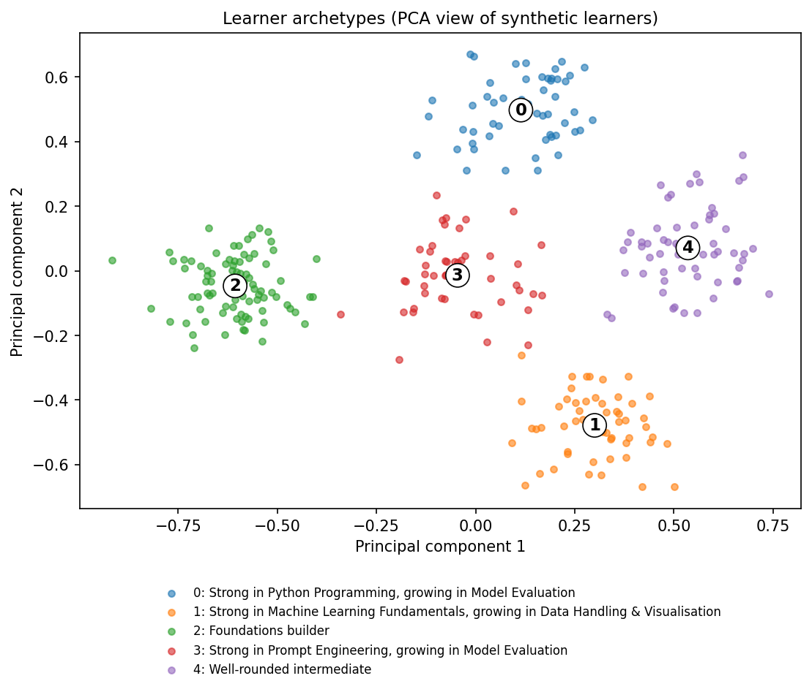

# 🧭 Personalised Learning Path Recommender

An end-to-end AI solution for **education**. A learner takes a short diagnostic quiz, and the app finds their
skill gaps, groups them into a **learner archetype** (unsupervised learning), recommends a
**prerequisite-ordered learning path** (content-based recommender) and builds a **4-week study plan**
that fits their weekly hours. An LLM can optionally write the plan's wording, but it never chooses the resources.

Built as the Week 4 individual AI Solution project of the CAPACITI / Clickatell AI Bootcamp.



---

## Use case mapping

| | |
|---|---|
| **User** | A self-taught learner or bootcamp student with limited time and no mentor |
| **Problem** | Too many courses, no idea what to study first, and generic roadmaps that ignore what they already know |
| **Current workflow** | Random YouTube and Coursera browsing, or a fixed curriculum |
| **This solution** | Diagnose, then recommend, then plan |
| **Success looks like** | Less time spent choosing what to study; recommendations that match real gaps |

---

## Quick start in VS Code

### 1. Prerequisites
- **Python 3.10 or newer** (3.11 or 3.12 recommended). Check with `python --version` (Windows) or `python3 --version` (macOS/Linux).
  Install from https://www.python.org/downloads/ if needed. On Windows, tick **"Add Python to PATH"** during install.
- **VS Code** with the **Python** extension (VS Code will suggest it when you open the folder).

### 2. Open the project
Unzip the folder, then in VS Code: **File → Open Folder…** and choose the `learning-path-recommender` folder
(the one that contains `app.py`).

### 3. Open a terminal
In VS Code: **Terminal → New Terminal**. Make sure it is inside the project folder.

### 4. Create a virtual environment and install packages

**Windows (PowerShell):**
```powershell
python -m venv .venv
.venv\Scripts\Activate.ps1
pip install -r requirements.txt
```
If PowerShell says *"running scripts is disabled"*, run this once and try the activate line again:
```powershell
Set-ExecutionPolicy -Scope Process -ExecutionPolicy Bypass
```
(Or use Command Prompt: `.venv\Scripts\activate.bat`.)

**macOS / Linux:**
```bash
python3 -m venv .venv
source .venv/bin/activate
pip install -r requirements.txt
```

When the environment is active, your prompt starts with `(.venv)`.
If VS Code asks *"We noticed a new environment…"*, click **Yes**. Otherwise press
`Ctrl+Shift+P` → **Python: Select Interpreter** → choose the one inside `.venv`.

### 5. Run the app
```bash
streamlit run app.py
```
Your browser opens at http://localhost:8501. (If Streamlit asks for an email the first time, just press **Enter**.)
Stop the app with `Ctrl+C` in the terminal.

Tip: use the **"Just exploring? Try a demo profile"** box to skip the quiz while testing.

---

## Optional: AI-written plan wording (Groq)

The app works fully without this. To let an LLM write friendlier wording for the plan:

1. Create a free key at https://console.groq.com
2. Copy `.env.example` to a new file called `.env` and paste your key after `GROQ_API_KEY=`
   (or paste it in the app's sidebar when you switch the toggle on).
3. Restart the app and switch on **"Let an AI (Groq) write the plan wording"**.

**Safety design:** the LLM receives only topic scores and your goal text. It writes a summary, weekly goals, tips
and a "why" line per resource. It **cannot** add or change resources. Its JSON reply is validated, and anything
with links, unknown resource ids or the wrong shape is thrown away and replaced by the built-in text.
If Groq is unreachable, the app falls back to the built-in plan.

Never commit your `.env` file (it is already in `.gitignore`).
If you see a "model not found" error, Groq may have retired the default model: pick a current one from
https://console.groq.com/docs/models and set `GROQ_MODEL` in `.env`.

---

## Run the tests and evaluation

```bash
python -m unittest discover -s tests -v     # 25 tests, no internet or API key needed
python scripts/evaluate.py                  # writes plots + report to outputs/
python scripts/generate_data.py             # regenerates data/synthetic_students.csv
```
`scripts/evaluate.py` creates `outputs/k_selection.png`, `outputs/clusters_pca.png` and
`outputs/evaluation_report.md`. Use these for your portfolio.

For a step-by-step explanation, open `notebooks/01_clustering_and_recommender.ipynb` in VS Code
(install the Jupyter extension if prompted, and select the `.venv` kernel). You may need
`pip install ipykernel` first.

You can also press **F5** in VS Code and choose **"Streamlit: run app.py"** to run the app with the debugger.

---

## How it works

```
Quiz → skill vector ─┬─► K-Means → learner archetype + pacing advice
                     └─► Content-based recommender → ordered path ─► weekly scheduler ─► plan
                          (gap vs. resource, level fit,                                   │
                           prerequisites, time budget, goal text)        optional LLM wording (validated)
```

Full diagram and scoring formula: [`docs/architecture.md`](docs/architecture.md).

| Component | File | Technique |
|---|---|---|
| Quiz and scoring | `src/quiz.py`, `data/quiz_questions.json` | 18 questions, 6 topics |
| Synthetic learners | `src/data_generation.py` | 5 designed archetypes plus noise (300 rows) |
| Archetypes | `src/clustering.py` | K-Means, k chosen by silhouette, PCA for plotting |
| Recommender | `src/recommender.py` | Cosine similarity, difficulty fit, prerequisites, time budget, TF-IDF goal match |
| Planner | `src/planner.py` | Greedy weekly scheduler plus validated LLM wording |
| Orchestration | `src/pipeline.py` | One function chains every stage |
| Interface | `app.py` | Streamlit |

## Project structure

```
learning-path-recommender/
├── app.py                     Streamlit interface
├── requirements.txt
├── .env.example               copy to .env for the optional Groq key
├── data/
│   ├── resources.csv          the resource catalogue (edit me!)
│   ├── quiz_questions.json    the quiz (edit me!)
│   └── synthetic_students.csv generated learners
├── src/                       all the logic (config, quiz, clustering, recommender, planner, pipeline, visuals)
├── scripts/                   generate_data.py, evaluate.py
├── tests/test_core.py         25 unit tests
├── notebooks/                 step-by-step explanation notebook
├── docs/                      architecture + portfolio page template
└── outputs/                   plots and evaluation report
```

---

## Customising

- **Resources:** edit `data/resources.csv`. Columns: `id, title, provider, topic, secondary_topic, difficulty (1-3), format, hours, url, description`.
  Topics must be one of: `python, data, prompting, ml, evaluation, ethics`.
  Please open each link and check it still works. Courses and URLs change over time,
  and some Coursera entries link to a search page on purpose.
- **Quiz:** edit `data/quiz_questions.json` (`answer` is the zero-based index of the correct option).
- **Different subject?** Change `TOPICS`, `TOPIC_LABELS`, `PREREQUISITES` and `TOPIC_ORDER` in `src/config.py`,
  then update the quiz, catalogue and the archetypes in `src/data_generation.py`.
- **Tuning:** weights and thresholds are all in `src/config.py`.

## Deploy for free (portfolio demo link)

1. Create a GitHub repo and push this folder (the `.gitignore` already protects your secrets):
   ```bash
   git init
   git add .
   git commit -m "Learning path recommender"
   git branch -M main
   git remote add origin https://github.com/<your-username>/learning-path-recommender.git
   git push -u origin main
   ```
2. Go to https://share.streamlit.io, sign in with GitHub, click **Create app**, pick the repo, branch `main`, main file `app.py`.
3. Optional: under **Advanced settings → Secrets**, add `GROQ_API_KEY = "your_key"`.
4. Put the live URL on your portfolio. A page template is in `docs/portfolio_page_template.md`.

## Troubleshooting

| Problem | Fix |
|---|---|
| `streamlit: command not found` | The virtual environment is not active. Activate it (step 4) and retry, or run `python -m streamlit run app.py`. |
| `ModuleNotFoundError: No module named 'src'` | Run commands from the project root (the folder containing `app.py`). |
| `ModuleNotFoundError` for another package | Run `pip install -r requirements.txt` with the `.venv` active. |
| VS Code uses the wrong Python | `Ctrl+Shift+P` → **Python: Select Interpreter** → pick the `.venv` one. |
| "AI wording was unavailable" message | Check the key and model name; the built-in plan is shown instead, so nothing is lost. |
| Port already in use | `streamlit run app.py --server.port 8502` |

---

## Responsible AI, honest limitations

- **Privacy:** no names or personal data are collected or stored. If AI wording is on, only topic scores and the goal text are sent to Groq.
- **Transparency:** every recommendation shows why it was chosen. The ranking is plain, inspectable maths.
- **Hallucination control:** the LLM never picks resources; its output is validated (known ids only, no links, size limits).
- **Synthetic data:** the learner population used for clustering is **generated**, not real students.
  A high clustering score on it shows the pipeline works, not that these archetypes exist in the real world.
- **Catalogue bias:** the tool can only recommend what is in `resources.csv`, which reflects its author's choices.
  It leans towards free, English-language, Python-centred material.
- **Labelling risk:** archetype names describe a learning pattern, not a person's ability. A short quiz is a rough snapshot.
- **Cold start and coarse scores:** with 3 questions per topic, scores come in steps of 33%.
- **Human oversight:** this is a decision-support tool. A teacher or mentor should have the final say.
- **Next steps:** real learner data (with consent), collaborative filtering, adaptive quizzes, more languages.

## Credits

Resources are links to material published by Kaggle, Coursera course providers, scikit-learn, pandas, Google,
Microsoft, Anthropic and others. This project is not affiliated with or endorsed by any of them.
