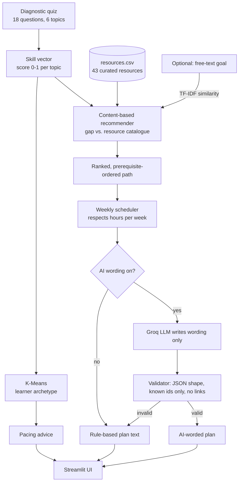

# Architecture



## Design decisions

| Decision | Why |
|---|---|
| The recommender is classical ML / maths, not an LLM | Every pick is explainable and reproducible, and it works offline. |
| The LLM only writes wording | It cannot invent resources or links. Its JSON is validated, and bad fields are replaced. |
| Content-based, not collaborative filtering | There is no real user history (cold start). Content-based works from the first student. |
| K-Means on synthetic learners | Gives archetypes for pacing advice and a clear unsupervised-learning component. |
| Streamlit | Python only, free hosting on Streamlit Community Cloud, quick to demo. |

## Scoring formula

```
gap      = 1 - skill (per topic)
resource = 1.0 on its primary topic, 0.2 on its secondary topic

base  = 0.5 * cosine(gap, resource)
      + 0.3 * gap in the resource's primary topic
      + 0.2 * difficulty fit          (skill < 0.4 -> level 1, < 0.75 -> level 2, else level 3)

score = base
      * 0.6  (or 0.85 for level 1)    if a prerequisite topic is weak (< 0.4)
      * 1.25                           if this weak topic blocks other weak topics ("foundation first")
      * 0.75 / 0.4                     if the resource is long / longer than the whole 4-week budget
      + 0.2 * TF-IDF similarity        to the typed goal (if any)
```

The top 8 are chosen (max 3 per topic) and then **ordered** by prerequisite chain:
Python → Data → Prompting → ML → Evaluation → Responsible AI, easiest first.

Prerequisites are defined in `src/config.py`:
`data ← python`, `ml ← python, data`, `evaluation ← ml`.

## Mapping to the Week 4 requirements

| Requirement | Where it is covered |
|---|---|
| End-to-end AI solution for a chosen industry | Education: quiz → profile → clustering → recommendations → plan → UI |
| Functional prototype | `streamlit run app.py` |
| AI solution architecture | The diagram above |
| Workflow integration | `src/pipeline.py` chains every stage; the plan can be downloaded as Markdown |
| Responsible AI considerations | README section, in-app "How this works and its limits", validator in `src/planner.py` |
| Real-world use case mapping | README "Use case mapping" table |
| Supervised / unsupervised learning link | K-Means clustering, silhouette evaluation, content-based recommender |
